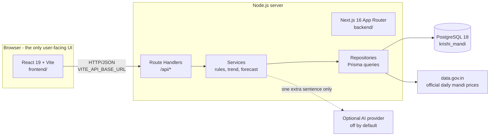
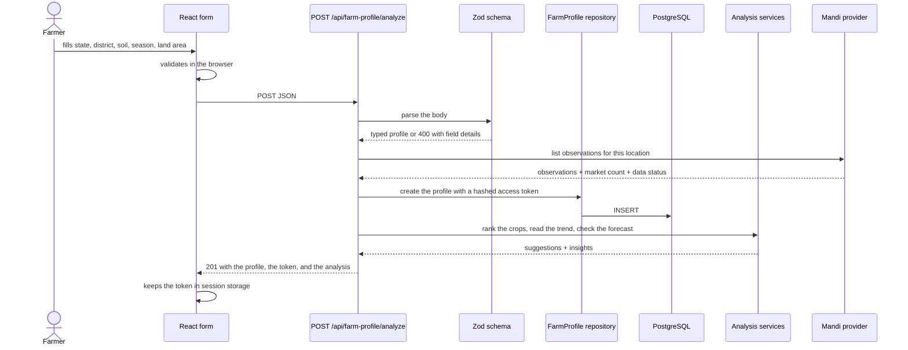
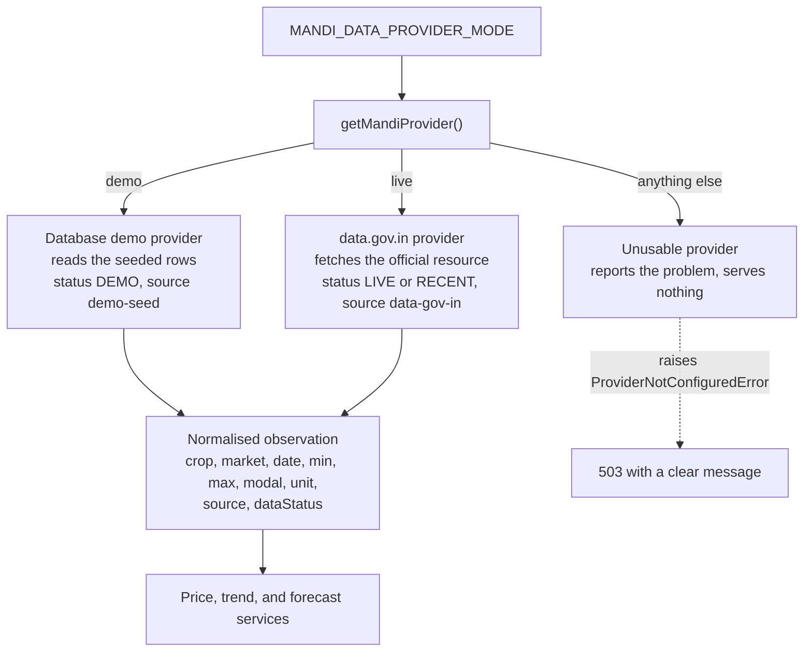
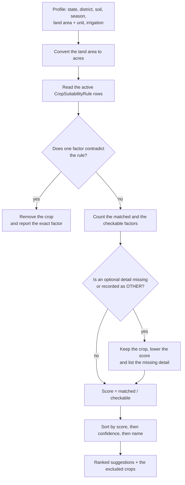
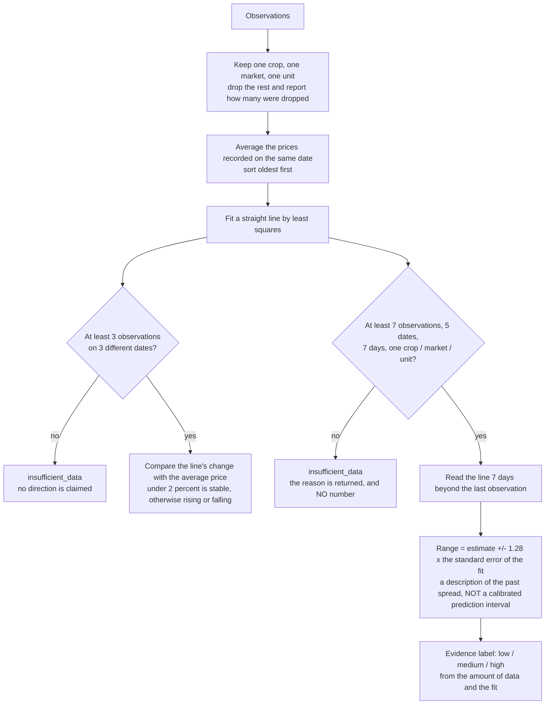
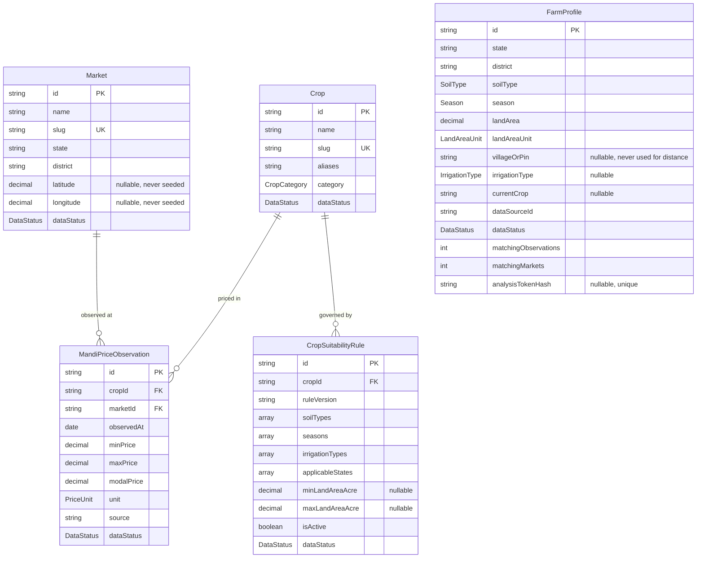
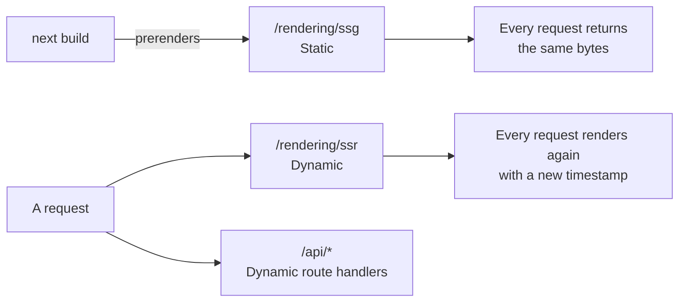

# Architecture

This document explains how the Krishi Mandi platform is put together, in
enough detail to present it to a React instructor, a Next.js instructor, and
the examiner. It describes the code that exists; nothing here is a plan.

The short version: **a React application does all the presenting, a Next.js
application does all the thinking, and PostgreSQL holds the data.** The
browser never touches the database, and the database never talks to the
browser.

## 1. The two applications



| Application | Stack | Responsibility |
| ----------- | ----- | -------------- |
| `frontend/` | React 19, Vite, TypeScript | Every screen, every form, every chart. It renders data the API returned and nothing else. |
| `backend/` | Next.js 16 App Router, TypeScript | The HTTP/JSON API, all validation, all domain logic, the provider abstraction, and the database access. |
| _(root)_ | npm workspaces | Installs, builds, and runs both applications together. |

The rule that keeps the two apart: **the browser may only receive
`VITE_*` variables.** The database URL, the data.gov.in key, and the AI key
are read on the server and never leave it. The frontend has no Prisma
dependency, no database connection, and no server-side code.

## 2. One request, end to end

This is the farmer-profile submission, which touches every layer.



The browser validation is a convenience. The server validates again, because
a request can come from anywhere (AGENTS.md section 5).

## 3. The provider abstraction

Both data sources sit behind one interface, `MandiPriceProvider`, so the
rest of the application never knows where a price came from.



Three properties of this design matter:

- **Demo data is never presented as live.** Every record carries a
  `dataStatus` and a `source`, and the UI shows them.
- **A failed upstream never substitutes demo rows.** The provider raises a
  `ProviderError`, the route answers `503`, and the profile that was
  already stored is kept.
- **An unknown mode fails loudly.** It does not quietly fall back to demo
  data, because that would pass seeded prices off as real ones.

## 4. The crop suitability flow



The result carries the rule version, the method, and the reasons, so the
farmer can see **why** a crop was suggested and **why** another was left
out. Missing information is never counted as a match.

## 5. The trend and forecast flow

Both calculations start from the same place: the observations that were
really recorded.



Two things to be clear about:

- The band around the estimate is a **standard-error band**, not a calibrated
  prediction interval. It leaves out the uncertainty of the fitted line
  itself and does not widen with the distance the line is read beyond the
  last observation. The method string that ships with the response says so.
- The evidence label describes the **evidence**, not the certainty of the
  outcome, so the UI words it as "Good evidence", "Fair evidence", or "Weak
  evidence".

## 6. The database model



`FarmProfile` stands on its own: it has no foreign key, because it is a
farmer's own record rather than a market record.

The important constraints:

| Table | Constraint | Why |
| ----- | ---------- | --- |
| `MandiPriceObservation` | unique on (crop, market, observedAt) | The same price is never stored twice for the same day |
| `Market` | unique on slug, and on (name, state, district) | A market is found by one stable key |
| `Crop` | unique on slug | The catalogue has one entry per crop |
| `CropSuitabilityRule` | unique on (crop, ruleVersion) | A rule set is versioned, not duplicated |
| `FarmProfile` | unique on `analysisTokenHash` | Two profiles never share an access token |

Every price-carrying table has a `dataStatus` and a `source`, so a seeded
row can never be mistaken for a verified one. The money columns are
`Decimal(12, 2)`, and the unit is stored next to the amount, so rupees per
quintal is never confused with rupees per tonne.

## 7. Reading a profile back, and the privacy boundary

The Phase 9 audit found that the old `GET /api/farm-profile/latest` returned
the most recently saved profile to anybody who asked. CORS is not
authentication, so on a shared deployment that would have shown one farmer's
state, district, soil type, and land area to every other visitor.

The replacement is a **capability token**, with no accounts and no login:

```mermaid
sequenceDiagram
    participant UI as React app
    participant API as Next.js API
    participant DB as PostgreSQL

    UI->>API: POST /api/farm-profile/analyze
    API->>API: create a 32-byte random token
    API->>DB: INSERT the profile with SHA-256(token)
    API-->>UI: 201 with the profile and the raw token (once)
    UI->>UI: keep the token in sessionStorage

    Note over UI,DB: later, in the same tab
    UI->>API: GET /api/farm-profile/analysis<br/>X-Analysis-Token: &lt;token&gt;
    API->>API: hash the header, check its shape
    API->>DB: find the profile by the hash
    DB-->>API: the profile, or nothing
    API-->>UI: 200 with the recomputed analysis, or 404
```

Only the hash is stored, so a copy of the database cannot be turned back
into a working token. The token lives in session storage, so it belongs to
one tab and disappears when the tab closes. The profile responses carry
`Cache-Control: no-store`.

## 8. The Next.js demonstration routes

The React app is the product UI. The Next.js app also keeps three small
pages that show the framework features the course asks for. They show no
market data and are not part of the farmer journey.

| Route | Kind | What it demonstrates |
| ----- | ---- | -------------------- |
| `/` | Server Component | A Server Component renders on the server; the page is static. |
| `/rendering/ssg` | SSG | The page is generated at build time. Two requests return byte-identical HTML. |
| `/rendering/ssr` | SSR | The page is rendered per request. The timestamp changes on every request. |



The API routes are dynamic as well: they call `await connection()` so
Next.js never tries to prerender a request that depends on the database or
the provider.

## 9. Where the truthfulness rules live

| Rule | Where it is enforced |
| ---- | -------------------- |
| Demo data is never shown as live | `dataStatus` on every record, the `StatusBadge` component, and the provider interface |
| No number without evidence | The forecast threshold in `forecastService.ts`, and the `insufficient_data` result |
| The band is not a prediction interval | `FORECAST_METHOD`, which ships with the response and is shown in the UI |
| No profit or yield promise | The disclaimer in the footer, the `notice` on the profile response, and the wording in the selling insights |
| The browser is never trusted | Every route re-validates with Zod |
| One farmer cannot read another's profile | The access token, and the absence of any "latest profile" route |
